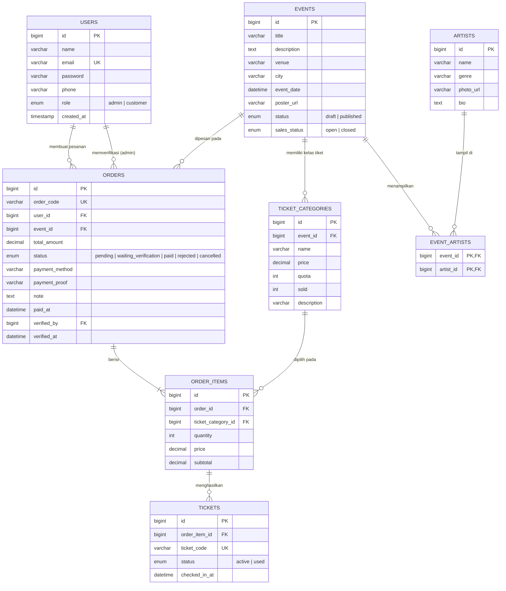

# ERD — Aplikasi Pemesanan Tiket Konser

## Diagram Relasi

## Penjelasan Relasi

| Relasi | Kardinalitas | Keterangan |
| --- | --- | --- |
| `users` → `orders` | 1 : N | Satu pelanggan dapat membuat banyak pesanan. |
| `users` → `orders.verified_by` | 1 : N | Admin yang memverifikasi pembayaran (nullable). |
| `events` → `ticket_categories` | 1 : N | Satu konser punya banyak kelas tiket (VIP, Festival, dll). |
| `events` ↔ `artists` | N : M | Lewat tabel pivot `event_artists` (line-up konser). |
| `events` → `orders` | 1 : N | Pesanan selalu terikat pada satu konser. |
| `orders` → `order_items` | 1 : N | Satu pesanan dapat berisi beberapa kelas tiket. |
| `ticket_categories` → `order_items` | 1 : N | Kelas tiket dapat dipilih di banyak pesanan. |
| `order_items` → `tickets` | 1 : N | Satu item dengan qty N menghasilkan N baris tiket unik (QR). |

## Aturan Bisnis Penting

1. **Kuota** — `ticket_categories.quota` adalah total tiket, `sold` bertambah saat pesanan dibuat (kuota di-reserve).
   `CHECK (sold <= quota)` mencegah overselling di level database, ditambah pengecekan `FOR UPDATE` di transaksi API.
2. **Tutup penjualan** — `events.sales_status = 'closed'` membuat endpoint pemesanan menolak transaksi baru.
3. **Verifikasi pembayaran** — `waiting_verification` → `paid` (tiket + QR dibuat) atau `rejected` (kuota dikembalikan).
4. **Pembatalan** — pesanan `pending` / `waiting_verification` yang dibatalkan mengembalikan `sold`.
5. **Hapus data** — konser yang sudah punya pesanan tidak dapat dihapus; kelas tiket yang sudah dipakai pesanan juga tidak.
