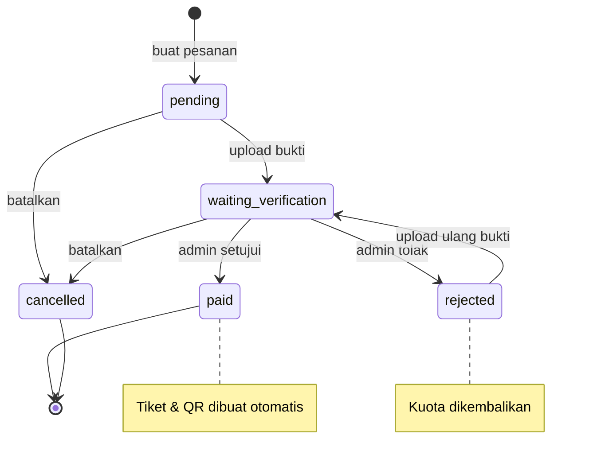

# FRD — Functional Requirement Document
## Aplikasi Mobile Pelanggan "Konseria"

| Item | Keterangan |
| --- | --- |
| Versi | 1.0 |
| Tanggal | 10 November 2026 |
| Status | Baseline untuk pengembangan MVP |
| Cakupan | Aplikasi mobile pelanggan (React Native) + integrasi REST API |
| Dokumen terkait | [BRD](BRD.md) · [PRD](PRD.md) · [ERD](../ERD.md) |

---

## 1. Tujuan Dokumen

Menjelaskan **perilaku fungsional** aplikasi mobile secara rinci dan dapat diuji: input, alur, aturan validasi, pemetaan ke endpoint API, serta kriteria penerimaan. Dokumen ini menjadi acuan developer mobile, QA, dan backend.

---

## 2. Aktor & Hak Akses

| Aktor | Deskripsi | Hak akses |
| --- | --- | --- |
| Pengunjung (guest) | Belum login | Lihat katalog & detail konser |
| Pelanggan | `role = customer` | Semua fitur pelanggan: pesan, bayar, lihat tiket |
| Admin | `role = admin` | **Ditolak** di aplikasi mobile; diarahkan ke panel web |

**Aturan:** login berhasil tetapi `user.role != "customer"` → tampilkan pesan "Akun admin hanya dapat menggunakan panel web" dan jangan simpan sesi.

---

## 3. Arsitektur Integrasi

| Item | Nilai |
| --- | --- |
| Base URL | `http://<host>:4000/api` |
| Autentikasi | `Authorization: Bearer <JWT>` (berlaku 7 hari) |
| Content-Type | `application/json` (kecuali upload: `multipart/form-data`) |
| Envelope sukses | `{ "success": true, "message": "...", "data": ... }` |
| Envelope error | `{ "success": false, "message": "...", "errors": { "field": "pesan" } }` |

### 3.1 Pemetaan Status HTTP

| Status | Arti | Perilaku aplikasi |
| --- | --- | --- |
| 200 / 201 | Sukses | Lanjutkan alur |
| 401 | Token tidak ada / kedaluwarsa | Hapus sesi, arahkan ke Login |
| 403 | Bukan pemilik data / bukan admin | Tampilkan pesan, kembali |
| 404 | Data tidak ditemukan | Tampilkan empty state |
| 409 | Duplikat (email sudah terdaftar) | Tandai field terkait |
| 422 | Validasi gagal / kuota tidak cukup | Tampilkan `message` dan `errors` per field |
| 5xx | Kesalahan server | "Terjadi kesalahan, coba lagi" + tombol retry |

---

## 4. Modul AUTH

### F-AUTH-01 Registrasi

| Aspek | Detail |
| --- | --- |
| Aktor | Pengunjung |
| Layar | S-03 Register |
| Endpoint | `POST /auth/register` |
| Prasyarat | Belum login |

**Alur utama**
1. Pengguna mengisi nama, email, password, nomor telepon (opsional).
2. Aplikasi memvalidasi input secara lokal (Tabel 9.1).
3. Aplikasi memanggil `POST /auth/register`.
4. Server mengembalikan `201` + `token` + `user`.
5. Sesi disimpan, pengguna diarahkan ke Home.

**Alur alternatif**
- `409` → tampilkan "Email sudah terdaftar" pada field email + tautan "Masuk".
- `422` → tandai field sesuai `errors`.
- Jaringan gagal → pesan "Tidak dapat terhubung ke server" + tombol coba lagi; data form tidak hilang.

**Request**
```json
{ "name": "Budi Santoso", "email": "budi@mail.com", "password": "rahasia123", "phone": "081234567890" }
```
**Response 201**
```json
{ "success": true, "message": "Registrasi berhasil. Selamat datang!",
  "data": { "token": "<jwt>", "user": { "id": 2, "name": "Budi Santoso", "email": "budi@mail.com", "phone": "081234567890", "role": "customer" } } }
```

**Kriteria penerimaan**
- Akun baru tersimpan di tabel `users` dengan `role = customer`.
- Password di-hash (bcrypt), tidak pernah dikirim balik ke aplikasi.
- Setelah sukses, pengguna langsung masuk tanpa perlu login ulang.

---

### F-AUTH-02 Login

| Aspek | Detail |
| --- | --- |
| Aktor | Pengunjung |
| Layar | S-02 Login |
| Endpoint | `POST /auth/login` |
| Prasyarat | Belum login |

**Alur utama**
1. Pengguna memasukkan email dan password.
2. Aplikasi memanggil `POST /auth/login`.
3. Server mengembalikan `token` + `user`.
4. Jika `user.role === "customer"`: simpan token di secure storage, arahkan ke Home.
5. Jika bukan customer: tampilkan pesan penolakan, jangan simpan sesi.

**Alur alternatif**
- `401` → "Email atau password salah" (tanpa membedakan mana yang salah).
- Token tersimpan tetapi `GET /auth/me` mengembalikan `401` → logout otomatis.

**Kriteria penerimaan**
- Sesi bertahan setelah aplikasi ditutup dan dibuka kembali.
- Logout menghapus token dari secure storage dan cache lokal.

---

### F-AUTH-03 Pemulihan Sesi

| Aspek | Detail |
| --- | --- |
| Trigger | Aplikasi dibuka (Splash) |
| Endpoint | `GET /auth/me` |

**Alur**
1. Splash membaca token dari secure storage.
2. Jika tidak ada → Login.
3. Jika ada → `GET /auth/me`.
4. `200` → Home. `401` → hapus sesi → Login.

---

## 5. Modul EVENT

### F-EVT-01 Katalog Konser

| Aspek | Detail |
| --- | --- |
| Aktor | Guest & Pelanggan |
| Layar | S-04 Home |
| Endpoint | `GET /events?search=&city=` |

**Alur utama**
1. Layar memuat daftar konser `published`, urut tanggal terdekat.
2. Setiap kartu menampilkan poster, judul, tanggal, kota/venue, harga mulai (`min_price`), dan progress kuota (`total_sold / total_quota`).
3. Pencarian dikirim sebagai `search` (nama/venue) dengan debounce 400 ms.
4. Filter kota mengirim parameter `city` (persis sama dengan nilai `city` di database).

**Alur alternatif**
- Hasil kosong → empty state "Belum ada konser yang cocok" + tombol reset filter.
- Gagal memuat → tampilkan retry, pertahankan data lama jika ada.

**Response field penting**

| Field | Tipe | Pemakaian di UI |
| --- | --- | --- |
| `id` | number | Navigasi ke detail |
| `title`, `poster_url` | string | Kartu konser |
| `event_date` | `YYYY-MM-DD HH:mm:ss` | Format "5 Des 2026, 19.30" |
| `venue`, `city` | string | Subjudul kartu |
| `sales_status` | `open` / `closed` | Badge "Tiket ditutup" |
| `min_price` | number | "Mulai Rp450.000" |
| `total_quota`, `total_sold` | number | Progress bar kuota |

**Kriteria penerimaan**
- Konser `draft` atau yang sudah lewat tidak muncul.
- Harga ditampilkan dengan format Rupiah tanpa desimal.

---

### F-EVT-02 Detail Konser

| Aspek | Detail |
| --- | --- |
| Aktor | Guest & Pelanggan |
| Layar | S-05 Detail |
| Endpoint | `GET /events/:id` |

**Alur utama**
1. Memuat detail: poster, judul, deskripsi, tanggal, venue, kota, line-up artis, daftar kelas tiket.
2. Setiap kelas menampilkan nama, harga, `remaining`, dan deskripsi singkat.
3. Kelas dengan `remaining = 0` ditandai "Habis" dan tidak dapat dipilih.
4. Tombol "Pesan Tiket" aktif hanya jika `sales_status = "open"` dan ada kelas dengan sisa > 0.
5. Jika pengguna belum login, menekan "Pesan Tiket" mengarahkan ke Login lalu kembali ke layar ini.

**Alur alternatif**
- `404` → "Konser tidak ditemukan" + kembali.
- `sales_status = "closed"` → banner "Penjualan tiket ditutup" dan CTA nonaktif.

**Kriteria penerimaan**
- Data yang ditampilkan identik dengan yang dikelola admin (tanpa cache lebih dari 60 detik).
- Sisa kuota dihitung dari server (`remaining`), bukan dihitung di aplikasi.

**Endpoint pendukung (opsional, sudah tersedia)**
`GET /events/:id/stats` → statistik live tanpa token: `percent_sold`, `sold_24h`, dan
`estimated_sold_out_at` per kelas tiket. Cocok untuk badge "Terjual 55%", label "Hampir habis",
atau hitung mundur "perkiraan sold out".

---

## 6. Modul ORDER

### F-ORD-01 Membuat Pesanan

| Aspek | Detail |
| --- | --- |
| Aktor | Pelanggan |
| Layar | S-06 Pilih Tiket → S-07 Checkout |
| Endpoint | `POST /orders` |
| Prasyarat | Login, `sales_status = open`, konser belum lewat |

**Alur utama**
1. Pengguna menaikkan/menurunkan jumlah per kelas (stepper, min 1, max 10).
2. Aplikasi menghitung subtotal dan total secara lokal untuk tampilan.
3. Di Checkout, pengguna memilih metode pembayaran dan menulis catatan (opsional).
4. Aplikasi memanggil `POST /orders`.
5. Server memvalidasi kuota dalam transaksi database, membuat `orders` + `order_items`, dan menambah `sold`.
6. Aplikasi menampilkan layar instruksi pembayaran (S-08) dengan `order_code` dan total dari server.

**Request**
```json
{
  "event_id": 1,
  "items": [
    { "ticket_category_id": 1, "quantity": 2 },
    { "ticket_category_id": 2, "quantity": 1 }
  ],
  "payment_method": "Transfer BCA",
  "note": "Mohon tiket dikirim via email"
}
```

**Alur alternatif & pesan**

| Kondisi | HTTP | Pesan yang ditampilkan |
| --- | --- | --- |
| Kuota tidak cukup | 422 | "Kuota kelas VIP tidak mencukupi. Tersisa 3 tiket." |
| Penjualan ditutup | 422 | "Penjualan tiket untuk konser ini sudah ditutup." |
| Konser sudah lewat | 422 | "Konser sudah berlalu, tiket tidak dapat dipesan." |
| Kelas bukan milik konser | 422 | "Kelas tiket tidak sesuai dengan konser yang dipilih." |
| Double tap tombol | — | Tombol di-disable selama request berjalan |

**Aturan bisnis**
- Satu pesanan hanya untuk satu konser.
- Total **selalu** diambil dari response server, bukan hasil hitung aplikasi.
- Item dengan kelas sama digabung otomatis oleh server.
- Kuota di-reserve saat pesanan dibuat (status `pending`).

**Kriteria penerimaan**
- Tidak ada pesanan yang melebihi kuota meski dua pengguna memesan bersamaan.
- Setelah sukses, `order_code` tampil dan dapat disalin.

---

### F-ORD-02 Upload Bukti Pembayaran

| Aspek | Detail |
| --- | --- |
| Aktor | Pelanggan (pemilik pesanan) |
| Layar | S-09 Upload Bukti |
| Endpoint | `POST /orders/:id/payment` (multipart) |
| Prasyarat | Status `pending` atau `rejected` |

**Alur utama**
1. Pengguna memilih gambar dari galeri/kamera.
2. Aplikasi menampilkan preview dan ukuran file.
3. Aplikasi mengirim `payment_proof` (wajib) dan `payment_method` (opsional).
4. Server menyimpan file, mengubah status menjadi `waiting_verification`, dan mengisi `paid_at`.
5. Aplikasi menampilkan status "Menunggu verifikasi admin".

**Batasan file**

| Aturan | Nilai |
| --- | --- |
| Format | JPG, JPEG, PNG, WEBP |
| Ukuran maksimum | 3 MB |
| Field multipart | `payment_proof` |
| Kompresi | Disarankan ≤ 1080 px sisi terpanjang sebelum upload |

**Alur alternatif**
- File terlalu besar → "Ukuran file maksimal 3 MB" tanpa memanggil server (validasi lokal).
- Status sudah `paid` → tombol upload disembunyikan.
- `403` → pesanan bukan milik pengguna.

**Kriteria penerimaan**
- Bukti dapat dilihat admin pada panel web setelah upload.
- Upload ulang diizinkan bila status `rejected`.

---

### F-ORD-03 Riwayat Pesanan

| Aspek | Detail |
| --- | --- |
| Aktor | Pelanggan |
| Layar | S-10 Riwayat |
| Endpoint | `GET /orders/my?status=` |

**Alur utama**
1. Menampilkan daftar pesanan terbaru lebih dulu.
2. Tab filter: Semua, Belum Bayar (`pending`), Menunggu Verifikasi, Lunas, Ditolak, Dibatalkan.
3. Setiap kartu: `order_code`, judul konser, tanggal konser, jumlah tiket (`ticket_count`), total, badge status.

**Alur alternatif**
- Belum ada pesanan → empty state + CTA "Jelajahi Konser".
- `401` → logout otomatis.

---

### F-ORD-04 Detail Pesanan

| Aspek | Detail |
| --- | --- |
| Aktor | Pelanggan (pemilik) |
| Layar | S-11 Detail Pesanan |
| Endpoint | `GET /orders/:id` |

**Alur utama**
1. Menampilkan data pemesan, konser, rincian item (kelas, qty, harga, subtotal), total, status, metode bayar, bukti, dan catatan.
2. Aksi ditentukan status:

| Status | Aksi yang tersedia |
| --- | --- |
| `pending` | Upload bukti, Batalkan pesanan |
| `waiting_verification` | Lihat bukti, Batalkan pesanan, hubungi admin |
| `paid` | Lihat tiket & QR |
| `rejected` | Lihat alasan (`note`), Upload ulang bukti |
| `cancelled` | Tidak ada aksi |

**Kriteria penerimaan**
- Alasan penolakan dari admin (`note`) terlihat jelas.
- Total pada detail sama dengan total saat pembuatan pesanan.

---

### F-ORD-05 Pembatalan Pesanan

| Aspek | Detail |
| --- | --- |
| Aktor | Pelanggan (pemilik) |
| Endpoint | `POST /orders/:id/cancel` |
| Prasyarat | Status `pending` atau `waiting_verification` |

**Alur utama**
1. Pengguna menekan "Batalkan Pesanan".
2. Muncul konfirmasi: "Kuota tiket akan dikembalikan. Lanjutkan?"
3. Aplikasi memanggil endpoint, status menjadi `cancelled`.
4. Kuota (`sold`) berkurang sesuai jumlah tiket.

**Alur alternatif**
- Status sudah `paid` → tombol tidak tampil; arahkan ke admin.
- `422` → tampilkan pesan server.

---

## 7. Modul TICKET

### F-TIX-01 Tiket Digital & QR

| Aspek | Detail |
| --- | --- |
| Aktor | Pelanggan (pemilik) |
| Layar | S-12 Tiket |
| Endpoint | `GET /orders/:id/tickets` |
| Prasyarat | Status pesanan `paid` |

**Alur utama**
1. Aplikasi meminta daftar tiket.
2. Server mengembalikan satu baris per lembar tiket: `ticket_code`, `category_name`, `status`, `qr_image` (data URL PNG), `qr_payload`.
3. Aplikasi menampilkan kartu tiket: judul konser, tanggal, venue, kelas, kode tiket, dan QR berukuran besar.
4. Tiket disimpan ke cache lokal agar tetap dapat dibuka tanpa jaringan.

**Alur alternatif**
- Status belum `paid` → `422` "Tiket hanya tersedia setelah pembayaran diverifikasi admin" → arahkan ke detail pesanan.
- `qr_image` gagal dirender → tampilkan `ticket_code` sebagai fallback manual.

**Aturan**
- `qr_image` adalah PNG base64; aplikasi **tidak** perlu membuat QR sendiri.
- Satu pesanan bisa menghasilkan lebih dari satu tiket (sesuai `quantity`).
- Tiket berstatus `used` ditandai "Sudah digunakan" dan QR diberi overlay abu-abu.

**Kriteria penerimaan**
- Jumlah tiket sama dengan total `quantity` pada pesanan.
- QR dapat dipindai dan menghasilkan `ticket_code` yang sama.

---

## 8. State Machine Pesanan



| Transisi | Pemicu | Efek data |
| --- | --- | --- |
| `pending → waiting_verification` | Pelanggan upload bukti | `payment_proof`, `paid_at` terisi |
| `pending/waiting_verification → paid` | Admin menyetujui | `verified_by`, `verified_at`, tiket dibuat |
| `pending/waiting_verification → rejected` | Admin menolak | `sold` dikurangi |
| `pending/waiting_verification → cancelled` | Pelanggan membatalkan | `sold` dikurangi |
| `rejected → waiting_verification` | Pelanggan upload ulang | `payment_proof` diperbarui |

---

## 9. Matriks Validasi Input

### 9.1 Klien (mobile)

| Field | Aturan | Pesan |
| --- | --- | --- |
| Nama | Wajib, 1–100 karakter | "Nama wajib diisi" |
| Email | Wajib, format email | "Format email tidak valid" |
| Password | Wajib, minimal 6 karakter | "Password minimal 6 karakter" |
| Telepon | Opsional, 8–20 digit | "Nomor telepon 8–20 digit" |
| Jumlah tiket | 1–10 per kelas | "Maksimal 10 tiket per kelas" |
| Bukti bayar | Wajib, JPG/PNG/WEBP, ≤ 3 MB | "Ukuran file maksimal 3 MB" |
| Catatan | Opsional, ≤ 1000 karakter | "Catatan terlalu panjang" |

### 9.2 Server (sumber kebenaran)

| Endpoint | Field | Aturan |
| --- | --- | --- |
| `POST /auth/register` | `email` | unik; duplikat → 409 |
| `POST /orders` | `items.*.quantity` | integer 1–10 |
| `POST /orders` | `event_id`, `ticket_category_id` | integer ≥ 1, kelas harus milik konser |
| `POST /orders` | `payment_method` | ≤ 50 karakter |
| `POST /orders` | `note` | ≤ 1000 karakter |
| `POST /orders/:id/payment` | `payment_proof` | mimetype gambar, ≤ 3 MB |

Aplikasi **wajib** menampilkan `errors` dari server per field, bukan hanya `message` global.

---

## 10. Matriks Traceability

| Fitur | Endpoint | Tabel terkait | Prioritas |
| --- | --- | --- | --- |
| Registrasi | `POST /auth/register` | `users` | Must |
| Login / sesi | `POST /auth/login`, `GET /auth/me` | `users` | Must |
| Katalog konser | `GET /events` | `events`, `ticket_categories` | Must |
| Detail konser | `GET /events/:id` | `events`, `ticket_categories`, `event_artists`, `artists` | Must |
| Buat pesanan | `POST /orders` | `orders`, `order_items`, `ticket_categories` | Must |
| Upload bukti | `POST /orders/:id/payment` | `orders` | Must |
| Riwayat | `GET /orders/my` | `orders`, `order_items` | Must |
| Detail pesanan | `GET /orders/:id` | `orders`, `order_items` | Must |
| Pembatalan | `POST /orders/:id/cancel` | `orders`, `ticket_categories` | Should |
| Tiket & QR | `GET /orders/:id/tickets` | `tickets`, `order_items` | Must |

---

## 11. Penanganan Error & Kondisi Khusus

| Kondisi | Perilaku aplikasi |
| --- | --- |
| Tidak ada koneksi | Tampilkan banner offline; tombol aksi nonaktif; tiket lunas tetap bisa dibuka dari cache |
| Timeout request (> 15 s) | Batalkan, tampilkan "Koneksi lambat, coba lagi" |
| Token kedaluwarsa saat aksi | Simpan draft aksi, arahkan login, lanjutkan setelah login |
| Server 500 | "Terjadi kesalahan pada server" + tombol coba lagi; jangan tampilkan stack trace |
| Data kosong | Empty state dengan ilustrasi dan CTA yang relevan |
| Double submit | Semua tombol kirim di-disable selama request berjalan |
| Aplikasi ditutup saat upload | Upload dianggap gagal; pengguna dapat mengunggah ulang |

---

## 12. Gap Analysis — Endpoint yang Belum Tersedia

Fitur berikut disebut di PRD tetapi belum didukung API. Perlu penambahan endpoint sebelum dikerjakan:

| Kebutuhan | Endpoint yang perlu dibuat | Dampak |
| --- | --- | --- |
| Ubah profil | `PATCH /api/auth/me` | F-14 hanya bisa menampilkan data, belum bisa mengubah |
| Notifikasi push | `POST /api/notifications/token` + trigger status | F-15 ditunda |
| Check-in QR petugas | `POST /api/tickets/checkin` | Scanner venue belum bisa dibuat |
| Batas waktu bayar | Kolom `expired_at` + job auto-cancel | Pesanan `pending` menahan kuota tanpa batas |
| Daftar kota untuk filter | `GET /api/events/cities` (opsional) | Filter kota memakai data unik dari katalog |

---

## 13. Definisi Selesai (Definition of Done)

1. Semua fungsi berprioritas **Must** berjalan sesuai alur utama dan alur alternatif.
2. Validasi klien dan server konsisten dengan Tabel 9.1 dan 9.2.
3. Tidak ada error console/crash pada pengujian perangkat Android 8+ dan iOS 14+.
4. Setiap error API memiliki pesan berbahasa Indonesia yang dapat ditindaklanjuti.
5. QR tiket berhasil dipindai dan kode sesuai dengan `ticket_code` di database.
6. Dokumen ini diperbarui bila ada perubahan kontrak API.
